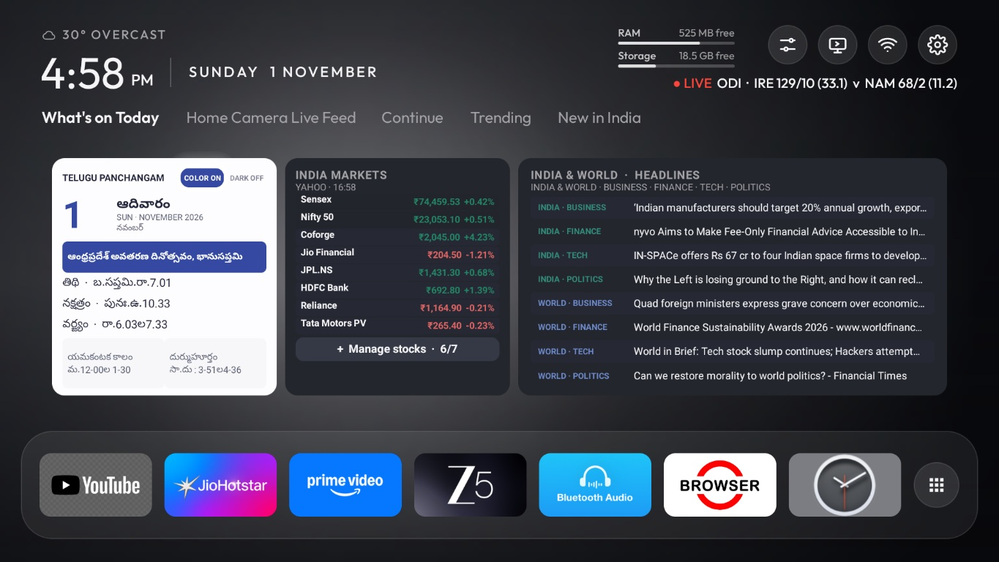
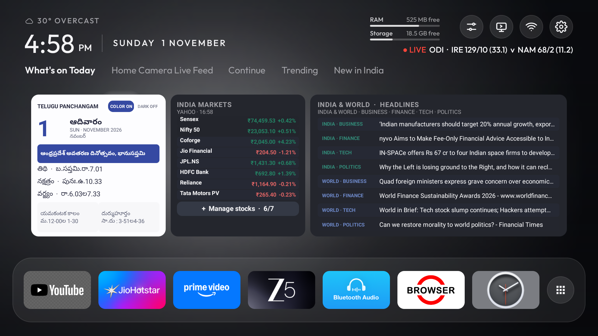
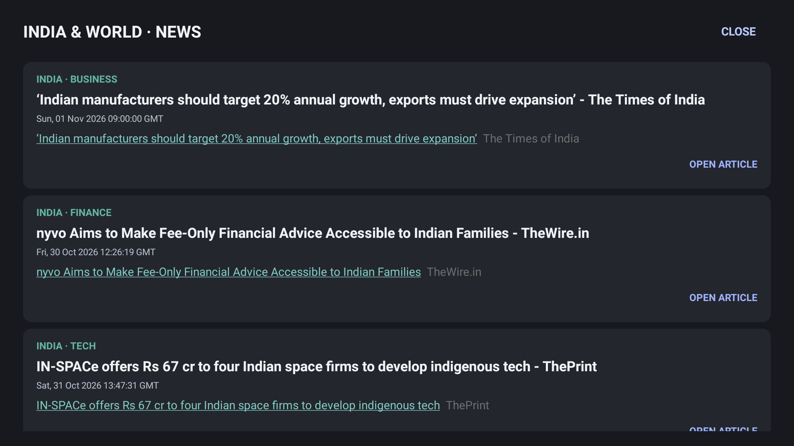
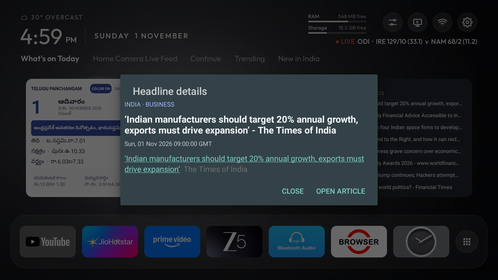
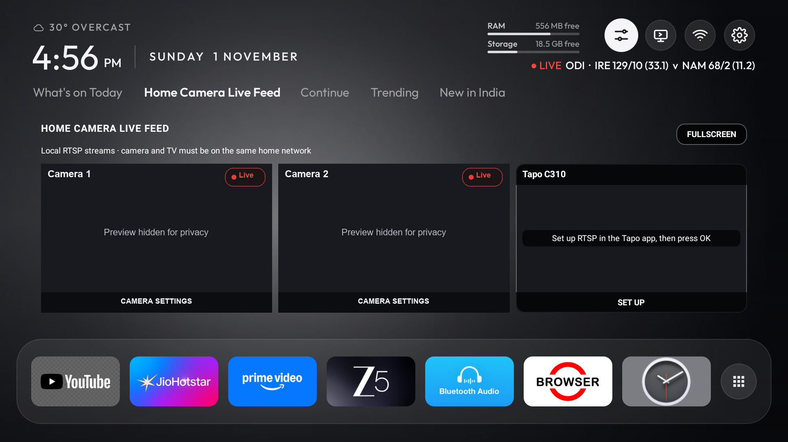
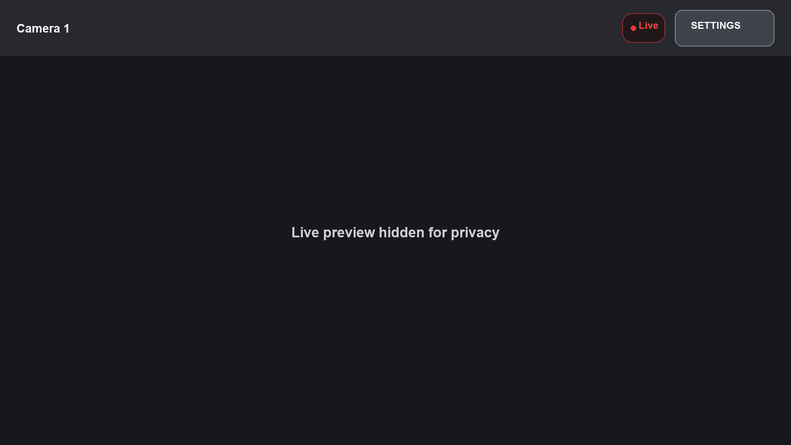

<p align="center">
  
</p>

<h1 align="center">ColourTV</h1>

<p align="center">
  A small, ad-free home screen for Android TV and Google TV, based on the MIT-licensed
  <a href="https://github.com/technoswaroop/ColourTV">ColourTV project by technoswaroop</a>.<br>
  One calm screen: your apps, what's trending where you live, live cricket and football, light by day and dark at night. Built on the source code from "https://github.com/rajupp/talkies"
</p>

<p align="center">
  <a href="#install"><b>Install</b></a> &nbsp;·&nbsp;
  <a href="#what-you-get"><b>What you get</b></a> &nbsp;·&nbsp;
  <a href="docs/guide.md"><b>Guide</b></a> &nbsp;·&nbsp;
  <a href="#questions-and-fixes"><b>Questions</b></a> &nbsp;·&nbsp;
  <a href="#support-original-project"><b>Support</b></a>
</p>

<p align="center">
  <a href="https://github.com/technoswaroop/ColourTV/releases/latest"><b>Latest release</b></a> · free and open source (MIT) · made by TechnoSwaroop
</p>

## What you get

- **No ads, no sponsored rows, no tracking.** ColourTV shows your apps and what you choose, nothing else.
- **Your apps** in a dock of 5 to 10 (seven to start), the rest a click away with the **All apps** button at its end. Hold OK on
  any app to move, hide or uninstall it.
- **What's on Today:** three cards for the Telugu day-view almanac, Sensex/Nifty and up to seven watchlist stocks,
  and headlines covering business, finance, tech and politics in India and around the world. Select a headline for
  its full feed details or open the linked article. Calendar colour and dark toggles are independent. Quotes refresh
  about once a minute and may be delayed by Yahoo.
- **Home Camera Live Feed:** a separate three-camera grid for local Tapo C210/C310 RTSP streams, with a fullscreen view
  for all three and an optional camera-feed screensaver. Give each camera a custom name in its setup dialog. Camera
  credentials are encrypted with Android Keystore and streams stop when you leave the tab.
- **For You:** what's trending on *your* streaming apps in *your* country, what's new there, and Continue watching.
  Only titles that stream on a subscription you can use; hide it for a big clean clock instead.
- **Live cricket and football** on the home screen, with your country's teams and leagues first.
- **Weather** at a glance, with the next hours and days in Control Center.
- **Control Center:** what's playing (pause, skip), sleep timer, turn off, free up memory, speed test, Bluetooth,
  sound output and more, one button away.
- **Inputs** that know your devices: "PlayStation 5 · On", "Fire TV · Standby".
- **Remote buttons with a new job:** make any spare button open an app, and give it a second job when held.
- **Your apps' channel rows** below the dock (Netflix, YouTube, JioHotstar…), the ones you pick, in your order.
- **Light by day, dark at night**, following your sunrise and sunset. **Your own wallpaper**, sent from your phone or
  picked from the TV or a USB drive, or Bing's picture of the day.
- **Updates itself:** a bell tells you when a new version is out, and OK installs it.

## Feature screenshots

| What's on Today | Full-screen headlines |
|---|---|
|  |  |

| Headline details | Camera dashboard |
|---|---|
|  |  |

| Single-camera fullscreen |
|---|
|  |

## What's on Today

The first home tab brings a Telugu panchangam, Indian market quotes and a curated set of India and world headlines into
one glanceable dashboard. Its three cards keep the calendar, markets and news visible together instead of hiding them
in separate apps or menus.

- **Telugu day view:** See the weekday and date, tithi, nakshatra, varjyam, festival, yamagandam and durmuhurtham
  details. The supplied almanac includes October–December 2026; other dates still show the local weekday and date.
  Choose the calendar's colour and dark appearance independently of the rest of the launcher.
- **Markets and watchlist:** Follow the Sensex and Nifty 50 alongside up to seven selected stocks. Manage the list
  from the Markets card: choose from Coforge, Jio Financial Services, HDFC Bank, Reliance Industries and Tata Motors
  Passenger Vehicles, or enter another Yahoo Finance ticker such as `TCS.NS`. Quotes refresh periodically when
  ColourTV is visible and online; Yahoo Finance data can be delayed or rate-limited and is not guaranteed to be live.
- **India and world headlines:** Browse news grouped across business, finance, technology and politics for both
  India and the world. Select the card heading to open the full-screen list; select an individual headline to read
  its feed details and follow its source article. Headlines come from Google News RSS and need an internet connection.

## Home Camera Live Feed

Configure up to three local RTSP cameras in the dedicated camera tab. The camera and TV must share your home network;
for Tapo cameras, enable RTSP in the Tapo app and create a Camera Account, then enter that account and the camera's
local IP in ColourTV. The camera account is separate from your Tapo cloud login. Name each camera during setup so its
name appears on the feed.

Select a configured tile to view just that camera fullscreen, or choose **Fullscreen** for the three-camera layout:
one large feed on the left and two evenly stacked feeds on the right. Live indicators, camera names and Settings stay
available over the feeds. The optional **ColourTV Camera Live Feed** screensaver reuses the configured cameras and
fullscreen layout. Camera credentials are encrypted on the TV; feeds stop when you leave the camera tab or pause the
app.

**Set for where you live, and yours to change.** ColourTV works out your country from the TV's time zone (many TVs
stay on "English (United States)" wherever they are), and almost everything on the screen can be changed:

| | Set for your country | You can change |
|---|---|---|
| **Weather** | °C or °F; day and night follow your sunrise and sunset | The area (a town or `lat,lon`), in ColourTV settings → Keys and location |
| **For You** | What's on Today uses the supplied Telugu almanac data (October–December 2026); headlines and market quotes need an internet connection. Yahoo Finance quotes may be delayed. Jio Platforms is unlisted; Jio Financial Services is available as a separate listed stock. Trending and *New in your country* only show titles that stream on a subscription where you are, on your apps (no streaming apps: their trailers in YouTube) | Show or hide it; toggle calendar colour and dark styles; add or remove up to seven stock symbols in What's on Today |
| **Home Camera Live Feed** | Local RTSP from your configured cameras; requires RTSP enabled in Tapo and the TV and cameras on the same network | Configure, name or remove up to three cameras; select one tile for its own fullscreen view, use **Fullscreen** for all three, or select ColourTV Camera Live Feed in TV screensaver settings |
| **Dock** | — | Which apps (ColourTV settings → **Dock apps**, or hold OK on any app), how many (**Dock size**, 5 to 10) and their order (hold OK → **Move**); All apps in your order, recently opened first, or A to Z (**All apps order**); your own picture on any app (hold OK → **Change image**) |
| **Cricket** | Your team's matches first, then other internationals and your domestic competitions (IPL, Ranji Trophy… in India) | On or off |
| **Football** | Your country's leagues by default (Premier League, Champions League and ISL in India; MLS first in the US; Süper Lig in Turkey…) | Pick any leagues |
| **Channels, keys, look** | — | Which channel rows and their order, what each remote button does (tap and hold), Light, Dark or Auto, wallpaper |

| | |
|---|---|
|  |  |
| *Inputs: each HDMI device by name, with its brand's colour* | *Control Center* |
|  |  |
| *Weather: the next six hours…* | *…and OK again for the next six days* |
|  |  |
| *Hold OK on an app to remove, move or hide it* | *Live cricket and football below the dock* |
|  |  |
| *Bing wallpaper (ColourTV settings → Wallpaper → Picture of the day)* | *Inputs in the light look* |
|  |  |
| *Light by day (Appearance: Auto follows sunrise and sunset)* | *For You hidden: a larger clock* |

ColourTV only replaces the home screen: it doesn't remove the TV maker's apps, ads services or tracking. To do that
too, use [CleanYourTV](https://github.com/Gathin23/cleanyourtv) first; ColourTV works alongside it.

## Install

**You need** an Android TV or Google TV with **Android 8.0 or newer**. ColourTV is built and tested on a OnePlus TV
(Google TV, Android 11); other TVs should work but haven't been tried. Samsung, LG, Roku and other TVs that don't run
Android can't use it.

Pick the way that suits you:

| | No computer | With a computer (recommended) | Ask an AI assistant |
|---|---|---|---|
| **How** | The *Downloader* app on the TV, code `5153858` | `adb`, 3 commands | Claude Code, Codex or Gemini CLI does it |
| **Everything works?** | Almost: no animation speed or self-repair (see below) | Yes | Yes |
| **Time** | 5 minutes | 10 minutes | 10 minutes |

### Without a computer

1. On the TV, install **Downloader** (by AFTVnews) from the Play Store.
2. Open it and type the code **`5153858`** in its home screen. It always gets the latest version. (Or type the
   full address: `github.com/technoswaroop/ColourTV/releases/latest/download/colourtv.apk`.) Downloader first shows a page
   naming the GitHub link it's about to load: choose to continue.
3. When Android asks, allow Downloader to install apps (*Install unknown apps*), then choose **Install**.
4. Open **ColourTV** from your apps and go on to [First-time setup](#first-time-setup).

A USB drive works too: copy `colourtv.apk` from the [latest release](https://github.com/technoswaroop/ColourTV/releases/latest)
onto it and open it with a file manager on the TV.

### With a computer

1. **On the TV**, turn on developer options: Settings → Device Preferences → About → press **Build** seven times.
   Then in Developer options turn on **USB debugging** (and **Network debugging** if there is one). Note the TV's
   IP address (Settings → Network & Internet → your Wi-Fi), like `192.168.1.20`.
2. **On the computer**, install `adb` (Mac: `brew install --cask android-platform-tools`; Windows and Linux:
   Google's [platform tools](https://developer.android.com/tools/releases/platform-tools)), download `colourtv.apk`
   from the [latest release](https://github.com/technoswaroop/ColourTV/releases/latest), and run, with your TV's address:
   ```bash
   adb connect 192.168.1.20:5555
   adb -s 192.168.1.20:5555 install -r colourtv.apk
   adb -s 192.168.1.20:5555 shell pm grant com.techpp.glass android.permission.WRITE_SECURE_SETTINGS
   ```
   Accept **Allow debugging?** on the TV the first time. The last line is optional: it lets ColourTV switch its Home
   button service back on by itself, change the animation speed, and turn network debugging off.
3. Go on to [First-time setup](#first-time-setup).

Only *Wireless debugging* on your TV, or `adb connect` refused? See [Connect to the TV](docs/building.md#connect-to-the-tv).

### Ask an AI assistant

Open an AI coding assistant on a computer on the same Wi-Fi as the TV, do step 1 above on the TV, and say:

> Install ColourTV (github.com/technoswaroop/ColourTV) on my TV at 192.168.1.20 from its latest release APK, and grant it
> WRITE_SECURE_SETTINGS. Ask me before changing anything else.

Then do the [First-time setup](#first-time-setup) on the TV.

**Building it yourself** instead, to change the code or the starting dock: see [docs/building.md](docs/building.md).

## First-time setup

On the TV, once. ColourTV settings → **Finish setup** shows whichever of these are still to do, and OK on each one
opens its switch.

| Step | Where | What it's for |
|---|---|---|
| **1. Home button** | Settings → Device Preferences → **Accessibility → ColourTV** → on | Keeps the Home button on ColourTV instead of the TV's own launcher. Also powers Turn off, the sleep timer and remote buttons |
| **2. Notification access** | Settings → Apps → Special app access → **Notification access → ColourTV** → on | Continue watching, Now playing and the update bell. ColourTV reads no notifications except the Play Store's update ones |
| **3. Two permissions** | ColourTV asks the first time it opens: allow both | Your Wi-Fi name (Android shares it only with location) and Android TV's Watch Next list |
| **4. Keys and weather** (optional) | ColourTV settings → **Keys and location → Send from your phone** | Scan the QR code with your phone and paste a free [TMDB](https://www.themoviedb.org/settings/api) key (picks), a free [CricketData](https://cricketdata.org) key (cricket) and your town (weather) |

> [!TIP]
> **Android 13 and newer** (Google TV Streamer, newer TVs) grey out the Accessibility and Notification access
> switches for apps installed from a file. Open Settings → Apps → ColourTV and choose **Allow restricted settings**
> from its menu, then turn the switches on. No such option (Google TV Streamer)? From a computer, once:
> `adb shell appops set com.techpp.glass ACCESS_RESTRICTED_SETTINGS allow`. Finish setup shows a
> **Switch greyed out?** row for this.

> [!NOTE]
> Android shows the same strong warning for every accessibility service. ColourTV' service filters only the Home
> button and the buttons you give a job, and notices only when the TV's own launcher, the Assistant or JioHotstar
> comes up; it reads nothing on screen except JioHotstar's search box, when you open a cricket match there.

Football scores need no key. Without a TMDB key, Trending and *New in your country* stay away (Continue still
works); without a CricketData key, so does cricket.

## Updates

ColourTV checks GitHub once a day while it's on screen. When a new version is out, a **bell** appears at the top right:
OK on **ColourTV x.y.z** downloads it and Android asks before installing it. ColourTV settings → **Updates** does the same
at any time. Your settings stay as they are.

- **The first time**, Android asks to allow ColourTV to install apps (*Install unknown apps*). Allowing it closes
  ColourTV, so open the bell or Updates again and press OK once more.
- **Keeps sending you back to that switch although it's on?** Some TVs leave an old "deny" behind; from a computer,
  `adb shell appops set com.techpp.glass REQUEST_INSTALL_PACKAGES allow` clears it.
- Only APKs from this project's releases, signed with its key, are installed. ColourTV checks the download's size and
  checksum against GitHub's, its version and its signature first.

**Coming from a version you built yourself** (0.4 or earlier)? It's signed with your own computer's key, so the
release APK can't install over it. Back up your settings (`./backup-settings.sh`), uninstall ColourTV, install the
APK as above, do the first-time setup again, and restore (`./restore-settings.sh`). The same two scripts move your
settings to another TV.

## Privacy

- **No account, no ads, no analytics.** Nothing about what you watch leaves the TV (except the opt-in YouTube
  lookup below), and your weather area goes only to the weather services.
- **What it connects to, and only while it's on screen:** TMDB for the picks (with your key), Open-Meteo and
  NOAA's aviationweather.gov for the weather, CricketData for cricket (with your key), ESPN's public scoreboard for
  football, Bing for the wallpaper (if you turn it on), GitHub once a day for updates, and Cloudflare when you run a
  speed test. Sharp YouTube pictures (off by default) looks a video's title up on YouTube.
- **Your keys, location and wallpaper** stay on the TV. *Send from your phone* (keys, and Wallpaper → From your
  phone) runs a one-time page on your home network for 5 minutes, and what you send goes straight to the TV. A photo
  is cropped on your phone first and arrives without its location or other details.
- **Continue watching** is built on the TV from Android TV's Watch Next list and what apps report while playing, and
  stays there.

## Questions and fixes

**How is it different from CleanYourTV?** CleanYourTV removes the TV maker's bloat, ads and tracking, and installs a
deliberately minimal launcher. ColourTV is a fuller home screen: picks, Continue, channel rows, live scores, weather,
Control Center and remote-button remapping. They work together: run CleanYourTV first, then install ColourTV.

| What you see | Why, and the fix |
|---|---|
| **Home opens Google TV** (or the TV's own launcher) | The ColourTV Accessibility switch is off ([First-time setup](#first-time-setup), step 1). A force stop turns it off; with the optional `pm grant` from the install, ColourTV turns it back on by itself. |
| **Accessibility switch greyed out**, or "Restricted setting" | Android 13 and newer: see the tip under [First-time setup](#first-time-setup). On a Google TV Streamer it needs the one `adb` command there. |
| **No Trending or New tabs**, only Continue | No TMDB key yet: ColourTV settings → **Keys and location** → *Send from your phone*. With a key, picks arrive within a minute of opening ColourTV with the TV online. No streaming app ColourTV recognises and no YouTube: the row says so. |
| **No weather** | ColourTV needs your town for it: ColourTV settings → **Keys and location**. |
| **Continue stays empty** | Notification access or the Watch Next permission is missing: ColourTV settings → **Finish setup**. |
| **Google Play Protect blocks the install** | Choose *More details* → *Install anyway*. ColourTV isn't on the Play Store, so Protect doesn't know it. |
| **"App blocked to protect your device"** (only a *Got it* button) | Play Protect blocks apps from outside the Play Store that ask for Accessibility or notification access, which ColourTV uses for Home, Turn off and Continue; it's about those permissions, not the app's code, and there's no *Install anyway*. Turn off Play Protect's scanning (Play Store → your profile → Play Protect → ⚙ → *Scan apps with Play Protect*), install, then turn it back on; ColourTV keeps working. Or install from a computer: `adb install colourtv.apk` isn't blocked. |
| **"App not installed."** | Usually a ColourTV you built yourself is already on the TV, signed with another key: see *Coming from a version you built yourself* under [Updates](#updates). On a first install, it can also be Play Protect refusing it without saying so: some TVs block apps from outside the Play Store that ask for Accessibility or notification access, which ColourTV uses for Home, Turn off and Continue. Turn Play Protect off (Play Store → your profile → Play Protect), install, then turn it back on; ColourTV keeps working. Otherwise, free some storage and try again. |
| **Inputs shows only Live TV** | Your device has no HDMI inputs of its own (a streamer like the Google TV Streamer or Shield). On a TV, its HDMI ports are listed. |
| **No Screensaver** in Control Center | Your device gives apps no way to start the screensaver, so ColourTV leaves the button out. It still starts by itself after the idle time set in the TV's settings. |
| **"Google Assistant is having a problem"** | The Google TV launcher was disabled. From a computer: `adb shell pm enable com.google.android.apps.tv.launcherx` |
| **Home opens a setup screen** | The ColourTV Accessibility switch is off, so Google TV's setup wizard answered Home: turn it on ([First-time setup](#first-time-setup), step 1). |
| **Home doesn't switch the TV to your box** (Google TV Streamer, Shield…) | Update to 1.1.3: ColourTV now lets Home through on a box, so Android can switch the input. You may see Google TV's home flash before ColourTV; to avoid it, make ColourTV the default Home app once, from a computer: `adb shell cmd package set-home-activity --user 0 com.techpp.glass/.HomeActivity` |
| **Holding Volume changes it only one step** | Some TVs stop repeating a held button while an app watches the remote, which ColourTV does for Remote keys. ColourTV settings → **Remote keys** → Off. Then holding Volume works, and Home shows Google TV's home for a moment before ColourTV. |
| **Screensaver shows Google's art, not your photos** | Installing with ColourTV' build script turned off Google TV's setup wizard, which Ambient mode needs for your Google Photos. From a computer, once: `adb shell pm enable com.google.android.tungsten.setupwraith`. Home stays on ColourTV. |
| `INSTALL_FAILED_UPDATE_INCOMPATIBLE` | The installed ColourTV was built on another computer: see *Coming from a version you built yourself* under [Updates](#updates). |
| `adb connect` says **No route to host** on a Mac | macOS's Local Network privacy is blocking your terminal: System Settings → Privacy & Security → Local Network → allow it. |
| No **Allow debugging?** prompt, or `unauthorized` | `adb kill-server`, then `adb connect` again with the TV on and its home screen showing. Some TVs only ask after Network debugging is switched off and on. |

**Close network debugging when you're done.** It lets devices on your Wi-Fi that you've allowed control the TV, and
ColourTV doesn't need it (updates come from the TV itself). On the TV: Developer options → USB debugging and Network
debugging off, and **Revoke USB debugging authorisations**; ColourTV settings → **Network debugging** shows whether
it's on.

**Going back to the TV's own home screen:** Settings → Apps → ColourTV → **Uninstall**, and the TV's launcher takes
Home again. From a computer with the source, `./restore.sh` also turns back on anything the build script turned off.

**Everything else** (every screen, setting and remote button): the [ColourTV guide](docs/guide.md). What changed in
each version: [CHANGELOG.md](CHANGELOG.md).

**Still stuck, or have an idea?** Ask or suggest it in [Discussions](https://github.com/technoswaroop/ColourTV/discussions).
[Issues](https://github.com/technoswaroop/ColourTV/issues) are for bugs: include your TV, Android version and ColourTV version.

## Support original project

ColourTV is based on the original MIT-licensed Talkies project by Raju · TechPP. To support its original maintainer,
you can [buy a popcorn 🍿](https://buymeacoffee.com/rajupp). Issues and discussions for ColourTV belong in this repo.

## Credits

Data (also listed in the app, ColourTV settings → About):

- **Picks:** [TMDB](https://www.themoviedb.org). *This application uses TMDB and the TMDB APIs but is not endorsed,
  certified, or otherwise approved by TMDB.* You use your own free API key, under TMDB's [terms of use](https://www.themoviedb.org/api-terms-of-use).
- **Weather:** [Weather data by Open-Meteo.com](https://open-meteo.com/), under
  [CC BY 4.0](https://creativecommons.org/licenses/by/4.0/); airport temperatures from NOAA's
  [aviationweather.gov](https://aviationweather.gov).
- **Cricket:** [CricketData.org](https://cricketdata.org), with your own key.
- **Football:** ESPN's public scoreboard (not an official API; ColourTV isn't affiliated with ESPN).
- **Speed test:** Cloudflare's public speed-test endpoint.

Code (details and license texts in `THIRD_PARTY_NOTICES.md`, all MIT):

- Control Center, and putting the accessibility service back after a force stop: tv-vibehack, now
  [CleanYourTV](https://github.com/Gathin23/cleanyourtv).
- The damped spring behind the motion, the trending row's idea, the QR code, the phone page and the updater:
  [Free My TV](https://github.com/simbasjungles/free-my-tv).
- The speed test, HDMI-CEC names and the update bell's approach: [Matinee](https://github.com/Jarvis322/matinee).
- Recognising consoles and players by what they announce over HDMI-CEC: [Luma](https://github.com/0xProbabillity/luma-tv).
- Tiles for apps without a TV banner: [GlassLauncher](https://github.com/tlfares/GlassLauncher).

Ideas (no code; ColourTV' own implementation):

- The hold-OK menu (Move, Uninstall, App info), removing a card from Continue, giving remote buttons a new job, and
  the Finish setup checklist: [Plume](https://github.com/aradhyas8/Plume_Launcher). Remote keys also follow CleanYourTV's.
- Bing wallpaper, channel cards in last-watched order and apps opening from their tile: Plume. Spotting a stopped
  accessibility service: [Matinee](https://github.com/Jarvis322/matinee).
- Starting the screensaver the way Google Assistant does, Recent apps and Control Center shortcuts:
  [tvOS Launcher](https://github.com/techgenius1/tvOS-Launcher) (ideas; no code copied).
- Bluetooth connect, Restart…, ColourTV at power-on, Empty inputs and the settings fallback for TVs that hide the
  standard settings screen: [CleanYourTV](https://github.com/Gathin23/cleanyourtv)'s launcher and add-ons.
- Now playing and the weather forecast: [Luma](https://github.com/0xProbabillity/luma-tv).
- Animation speed and Storage in Control Center: [GlassLauncher](https://github.com/tlfares/GlassLauncher).

The Outfit typeface is © The Outfit Project Authors, licensed under the SIL Open Font License 1.1 (`OUTFIT-OFL.txt`).

## License

[MIT](LICENSE) © 2026 TechPP.
